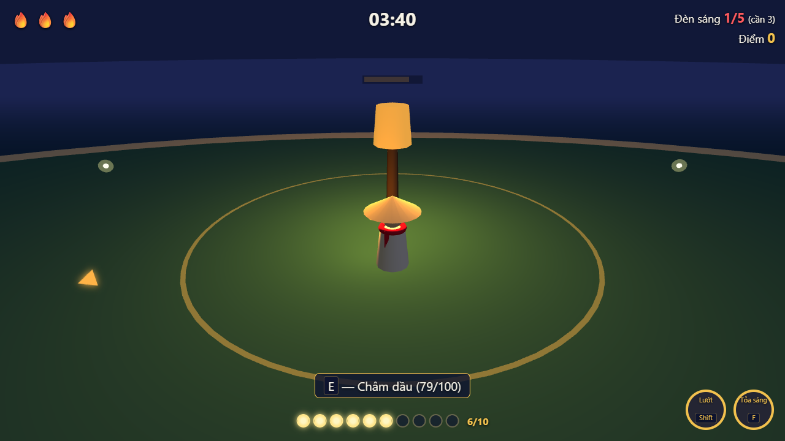
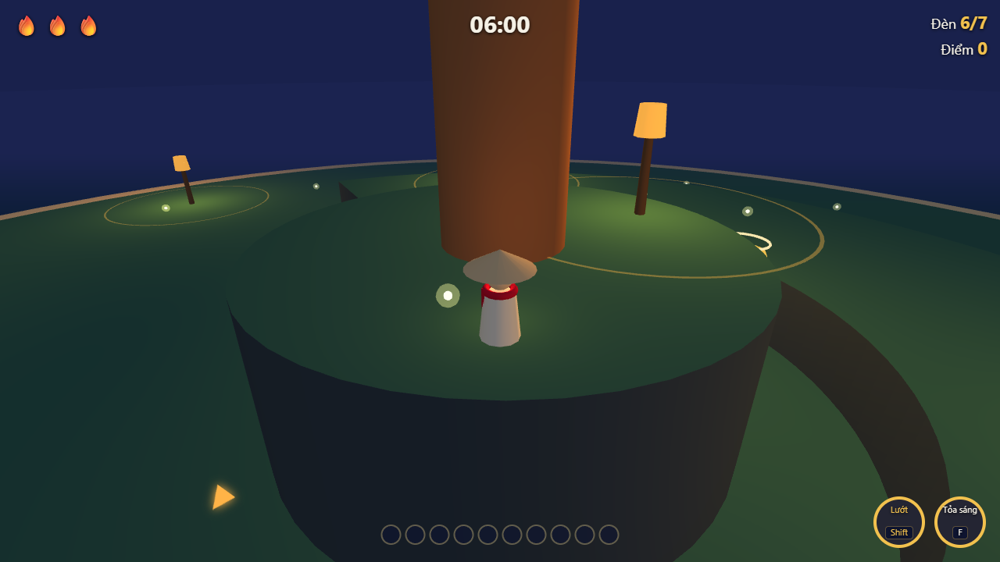
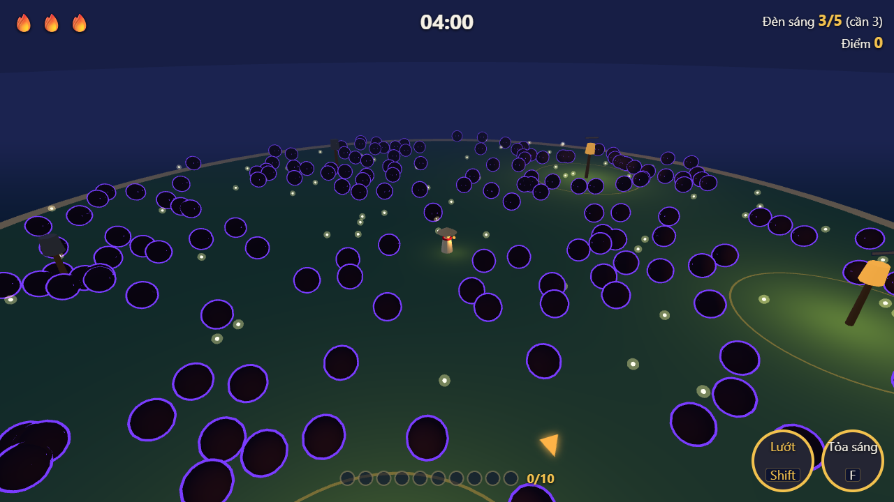

# Đảo Đèn Lồng — v1.0.0

Game 3D góc nhìn thứ ba chạy trên trình duyệt (Three.js). Mây, người giữ đèn nhỏ tuổi đội nón lá quàng khăn đỏ, phải **giữ các Đèn Lồng Lớn cháy tới bình minh** trên ba hòn đảo trong ba đêm. Đèn cạn dầu dần, Bóng Mực tìm tới hút dầu, Gió Lạc rình cướp đom đóm. Có chế độ **headless tất định**, **benchmark** và **soak test** theo Test Contract v1.3 ([game.contract.json](game.contract.json)).



| | |
|---|---|
|  |  |

> Video demo: [docs/demo/](docs/demo/) (đính kèm Release v1.0.0)

## Yêu cầu hệ thống

- **Node.js ≥ 18** để chơi, chạy test, headless và soak (đã thử với Node 20, 22, 24 trên CI). **Benchmark cần Node ≥ 22** (dùng `WebSocket` có sẵn để điều khiển Chrome); script báo lỗi rõ ràng nếu Node cũ hơn.
- Trình duyệt có **WebGL 2**: Chrome, Edge hoặc Firefox bản mới. Khuyên dùng GPU rời hoặc GPU tích hợp đời mới.
- **Benchmark** cần cài Google Chrome, Chromium hoặc Microsoft Edge. Script tự tìm trình duyệt; có thể chỉ định bằng `--chrome <đường dẫn>` hoặc biến `CHROME`.
- Windows 10/11, macOS hoặc Linux. Màn hình ≥ 1280×720.

## Cài đặt và chơi (3 lệnh)

```bash
git clone https://github.com/Stormaka/K5-L3A-Day12-HoangBaoNguyen-2A202603384-AI-SDLC.git dao-den-long
cd dao-den-long && npm install
npm start          # mở http://localhost:5173
```

**Không muốn cài npm?** Tải `dao-den-long-v1.0.0.zip` ở trang Release, giải nén rồi chạy `node server.js`. three.js đã có sẵn trong gói.

**Docker:**

```bash
docker build -t dao-den-long:1.0.0 .
docker run --rm -p 5173:5173 dao-den-long:1.0.0
```

## Điều khiển (đổi được trong Cài đặt → Đổi phím)

| Phím mặc định | Hành động |
|---|---|
| `W A S D` | Di chuyển (theo hướng camera) |
| Kéo chuột trái, `Q` / `C` | Xoay camera |
| `Space` | Nhảy |
| `Shift` trái | Lướt: 14 m/s trong 0.2 s, hồi 1.5 s |
| `E` | Đứng cách đèn ≤ 2 m: thắp (10 đom đóm), thắp lại (5), hoặc châm dầu (1 đom đóm = 10 dầu) |
| `F` | Tỏa Sáng: tốn 3 đom đóm, làm choáng và đẩy lùi Bóng Mực trong 5 m |
| `P` / `Esc` | Tạm dừng: Tiếp tục / Chơi lại Đêm / Cài đặt / Về menu |

**Cài đặt** (được lưu lại):
- Âm lượng, độ nhạy chuột.
- Đổi phím: báo khi trùng phím, có nút khôi phục mặc định.
- Bảng màu dễ phân biệt (cho người mù màu).
- Phụ đề / chỉ báo hình ảnh: Bóng Mực xuất hiện (kèm mũi tên chỉ hướng), gió sắp thổi, 10 giây cuối, đèn sắp cạn dầu.
- Giảm chuyển động: tắt rung camera và hiệu ứng chớp màn hình.
- Chữ lớn ×1.25. Chữ thường đã ≥ 18 px ở 1280×720.

## Luật chơi

- Ba Đêm (4:00, 4:30, 5:00).
- **Thắng:** còn sống lúc bình minh với ít nhất 60% số đèn **đang sáng** (3/5, 4/6, 5/7).
- **Thua:** hết 3 Ngọn Lửa, hoặc tới bình minh mà không đủ đèn sáng.
- **Dầu đèn:** đèn vừa thắp có 100 dầu và hao 1/s. Dưới 30 dầu, đèn nhấp nháy, mất vùng an toàn 6 m, và bị Bóng Mực hút dầu 5/s.
- **Sức chứa đom đóm:** ban đầu 10, mỗi lần thắp thành công +2, tối đa 20.
- **Ba hòn đảo:**
  - Đêm 2: hai đảo nối bằng cầu tre, có bục nhảy.
  - Đêm 3: ba tầng, có dốc, tháp chuông và gió mạnh.
- **Gió Lạc** cướp đom đóm. **Bùa Gió** cho chạy nhanh và lướt không cần hồi chiêu.
- **Điểm:**
  - +5 mỗi đom đóm nạp vào đèn.
  - +100 thắp lần đầu, +40 thắp lại.
  - +5 mỗi Bóng Mực trúng Tỏa Sáng (+15 nếu nó đang hút dầu).
  - Lúc bình minh, chỉ khi thắng: +50 + số dầu còn lại cho mỗi đèn sáng, +50 cho mỗi Ngọn Lửa.
- **Bảng xếp hạng:**
  - Sau màn Bình Minh hoặc khi thua, nhập tên (3–12 ký tự; chữ có dấu tiếng Việt cũng được) để lưu điểm.
  - Lưu top 10 vào `data/leaderboard.json`; đổi thư mục bằng biến `DDL_DATA_DIR`.
  - Xem trong menu → Bảng xếp hạng.

## Kiểm thử và công cụ

| Việc | Lệnh |
|---|---|
| Test tự động (73 test) | `npm test` |
| Kịch bản headless + bằng chứng (28 kịch bản, 2 lần mỗi kịch bản để kiểm tất định) | `npm run proof` |
| Headless (Test Contract) | `node src/headless.js --seed 1 --night 1 --ticks 600 --out out/run.jsonl [--scenario f.json] [--inputs f.json] [--snapshot-every 10]` |
| Benchmark (cửa sổ 1280×720, tắt vsync) | `node scripts/bench.js --seed 42 --duration 30 --out bench.json` |
| Soak test (10 Đêm trong 1 tiến trình) | `node --expose-gc scripts/soak.js --seed 7 --nights 10 --out soak.json` |
| Xuất bảng xếp hạng | `node server.js --export-leaderboard out.json` |
| Bot tự chơi (chứng minh Đêm thắng được) | `node scripts/bot.js <night> <seed> out.json` |
| Đóng gói bản Release | `npm run package` → `dist/dao-den-long-v1.0.0.zip` |

**Headless:**
- Mã thoát: `0` bình thường; `2` khi file inputs/scenario sai định dạng; `1` khi tham số sai.
- Một Đêm đầy đủ chạy dưới 1 s.

**Benchmark:**
- Mở Chrome có cửa sổ, ép viewport đúng 1280×720, tắt vsync bằng `--disable-gpu-vsync --disable-frame-rate-limit`.
- Dựng cảnh chuẩn: Đêm 1, 200 Bóng Mực, 100 đom đóm, L1–L3 sáng, camera bay vòng bán kính 30 m.
- Khởi động 3 s, đo 30 s, rồi ghi `bench.json`.
- `peak_mem_mb` là tổng bộ nhớ của cây tiến trình trình duyệt; cách đo được giải thích trong file kết quả.

**Kết quả tự đo** (máy dev, RTX 5050 Laptop): xem [docs/proof/phase-4/bench.json](docs/proof/phase-4/bench.json) và [soak.json](docs/proof/phase-4/soak.json).

## Tài liệu

- **Theo phase:**
  - Phase 1–4: ghi chú [docs/notes/](docs/notes/), bằng chứng [docs/proof/](docs/proof/).
  - Quyết định thiết kế: [docs/adr/](docs/adr/).
  - Lịch sử thay đổi: [CHANGELOG.md](CHANGELOG.md).
- **Tổng kết:** retro [docs/retro.md](docs/retro.md).
- **Bản quyền:** [CREDITS.md](CREDITS.md) · [LICENSE](LICENSE) (MIT).
- **Harness AI:**
  - [AGENTS.md](AGENTS.md), [CLAUDE.md](CLAUDE.md).
  - Hooks trong [.claude/settings.json](.claude/settings.json).
  - Skill [verify-game](.claude/skills/verify-game/SKILL.md).
  - CI [.github/workflows/ci.yml](.github/workflows/ci.yml) (Node 20/22/24) + [pre-push hook](.githooks/pre-push).
- **Đề bài lab gốc:** [docs/lab/](docs/lab/).
